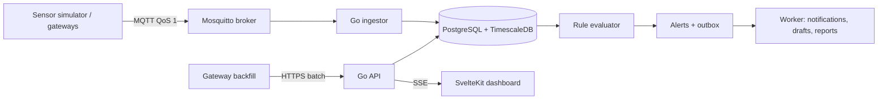

# ColdTrace

**Cold-chain temperature monitoring and excursion review.** ColdTrace ingests sensor readings from trucks and warehouses in near real time, detects temperature excursions with transparent rules, and gives quality reviewers a case file with all the evidence they need to make a decision.

> **Status:** early development, following a 7-week roadmap (see below). All sensors and shipments are simulated; this is not a validated GxP system and makes no regulatory compliance claims.

## The problem

Vaccines, insulin and fresh food must stay inside a temperature range. Data loggers record readings, but teams often learn about an excursion only after delivery, then sift through CSV exports and argue about whether a short spike while a door was open actually matters.

## Who it's for

- **Dispatchers:** monitor live shipments
- **Quality reviewers:** review cases and record the disposition decision
- **Site managers:** look after warehouse zones
- **Auditors:** read-only access
- **Device admins:** register sensors and gateways

## Demo workflow

1. The simulator runs 200 sensors across 40 trucks
2. Truck T-17's gateway loses connectivity for 25 minutes, then backfills readings out of order
3. The reefer sits above 8 °C for 34 minutes; rule `R-EXC-DUR-30` fires once, not once per reading
4. The dispatcher sees the alert within seconds
5. QA opens a case with the chart, the marked gap, mean kinetic temperature and every rule result
6. A drafted incident summary cites reading windows; QA edits it and records the disposition
7. Everything lands in the audit trail

## Planned features

- Orgs, sites, zones and role-based access
- Device registry with per-device broker credentials and calibration dates
- Versioned product profiles (range, max excursion, cumulative time, MKT limit)
- Shipments, legs and non-overlapping sensor assignments
- Idempotent, out-of-order-tolerant ingestion from MQTT and batch backfill
- Pure rule engine: threshold, duration, cumulative, gap and MKT rules
- One alert per shipment, rule and episode, with escalation
- Live dashboard over Server-Sent Events with stale-data indicators
- Case files with an immutable, hashed evidence snapshot
- Drafted incident summaries and corrective-action reports for human sign-off
- Shipment reports that reconcile with raw readings

## Tech stack

| Layer | Technology |
|---|---|
| Backend | Go (chi, pgx, sqlc) |
| Frontend | SvelteKit, TypeScript |
| Database | PostgreSQL with TimescaleDB |
| Messaging | MQTT (Eclipse Mosquitto) |
| Live updates | Server-Sent Events |
| Observability | OpenTelemetry |
| Local environment | Docker Compose |
| CI | GitHub Actions |

## Architecture

Sensors publish to an MQTT broker; a Go ingestor stores readings in TimescaleDB. A separate evaluator runs the pure rule engine over windows of readings and raises alerts through an outbox. The API serves the dashboard and streams live updates over SSE, and a worker handles notifications, drafts and reports.



### Planned repository layout

```text
coldtrace/
├── cmd/                   # api, ingestor, evaluator, worker, simulator
├── internal/rules/        # pure rule engine with golden tests
├── internal/mkt/          # mean kinetic temperature
├── internal/domain/       # devices, shipments, profiles, readings, alerts, cases
├── internal/store/        # sqlc queries, pgx pool
├── web/                   # SvelteKit dashboard
├── migrations/            # SQL migrations
├── fixtures/              # replay datasets and expected excursions
├── deploy/                # Compose, monitoring
└── docs/                  # architecture decisions, rules, runbooks
```

## Design rules

- Replaying the same fixture always produces identical excursions.
- Duplicate or out-of-order readings never create duplicate alerts.
- "No data" is a gap, not "in range".
- Evidence snapshots are immutable once a case is opened.
- Dispositions are always recorded by a human; drafts never decide.

## Roadmap

| Week | Focus | Status |
|---|---|---|
| Week 1 | **Domain design & Go/SvelteKit bootstrap** — Add charter, rule catalog draft, ADR 0001 and Go API skeleton, scaffold SvelteKit dashboard, Compose stack and sqlc queries | Planned |
| Week 2 | **Orgs, device registry & ingestion** — Add orgs, session auth and device registry with broker ACLs, add readings hypertable, MQTT ingestor and fleet simulator, add gateway backfill endpoint and ingestion tests | Planned |
| Week 3 | **Shipments, profiles & assignments** — Add versioned product profiles and shipment lifecycle, add non-overlapping device assignments and shipment views, add continuous aggregate rollups | Planned |
| Week 4 | **Rule engine, MKT & alerts** — Add pure excursion, gap and MKT rules with golden fixtures, add windowed evaluator with watermarks and alerts, add acknowledgment and escalation | Planned |
| Week 5 | **Live dashboard, case files & staging** — Add org-scoped SSE stream, dispatcher board and case files, add Postgres-backed job queue and pipeline telemetry, provision staging environment | Planned |
| Week 6 | **Incident summaries, dispositions & reports** — Add case facts envelope and validated incident summaries, add QA disposition, CAPA drafts and shipment reports, add natural-language filter parsing | Planned |
| Week 7 | **Hardening & release** — Audit org scoping, add limits, CSP and scanning, run ingestion abuse and chaos suites, tag release candidate with demo target and changelog, deploy public demo with monitoring | Planned |

## Getting started

Setup instructions will be added once the first services are in place.

## Documentation

- [Charter, personas and glossary](docs/charter.md)
- [Rule catalog (draft)](docs/rules/catalog.md)
- [ADR 0001: one Go module, several binaries](docs/adr/0001-one-go-module-several-binaries.md)
