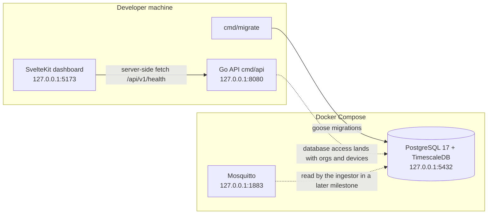

# Local setup

This guide covers what exists today: the Go API and migration tool, the
SvelteKit dashboard, and the Compose stack (TimescaleDB and Mosquitto). The
ingestor, evaluator, worker and simulator are added in later milestones.

## Prerequisites

| Tool | Version | Used for |
|---|---|---|
| Go | 1.26 (see `go.mod`) | API, migrations, tests |
| Node.js | 22.17 or newer | SvelteKit dashboard |
| Docker with Compose v2 | recent | TimescaleDB, Mosquitto, integration tests |
| GNU Make | 4.x | the commands below |
| golangci-lint | v2.15 | `make lint` (optional locally, enforced in CI) |
| sqlc | v1.29 | `make sqlc` / `make sqlc-check` (only when changing queries) |
| A C compiler | any | `make test-race` (the race detector needs cgo) |

## Quick start

```sh
cp .env.example .env      # then set POSTGRES_PASSWORD (and the same password in COLDTRACE_DATABASE_URL)
make dev
```

`make dev` runs three steps:

1. `make infra`: `docker compose up -d --wait` starts TimescaleDB and
   Mosquitto and waits for their health checks.
2. `make migrate`: applies the goose migrations embedded in
   `internal/store/migrations`.
3. `make run`: starts the Go API on <http://127.0.0.1:8080> and the
   dashboard on <http://127.0.0.1:5173>. Ctrl-C stops both; when either one
   exits, the other is stopped too.

Check that the API is up:

```sh
curl http://127.0.0.1:8080/api/v1/health
```

`make infra-down` stops the containers and keeps the data volumes;
`docker compose down -v` also deletes them.

All published ports are bound to `127.0.0.1`. The broker accepts anonymous
clients, which is only acceptable because of that; per-device credentials
replace it when the device registry lands.

## Make targets

Run `make help` for the full list.

| Target | What it does |
|---|---|
| `make dev` | `infra` + `migrate` + `run` |
| `make infra` / `make infra-down` | Start / stop the Compose stack |
| `make migrate` / `make migrate-status` | Apply migrations / show which are applied |
| `make api` / `make web` | Run only the API / only the dashboard |
| `make check` | `vet`, `lint`, `test`, `sqlc-check`, `web-check`, `web-test` |
| `make test-race` | Go unit tests with the race detector |
| `make test-integration` | Store tests against TimescaleDB (see below) |
| `make sqlc` | Regenerate `internal/store/db` after editing `internal/store/queries` |
| `make fmt` | gofmt + goimports |
| `make web-build` | Production build of the dashboard |

Every recipe loads `.env` first, so the Go binaries and the dashboard use the
same values as Compose.

## Environment variables

Copy `.env.example` to `.env`; `.env` is git-ignored. Empty values count as
unset.

### Compose

| Variable | Default | Notes |
|---|---|---|
| `POSTGRES_USER` | `coldtrace` | Database superuser created by the container |
| `POSTGRES_PASSWORD` | none, required | Compose refuses to start without it |
| `POSTGRES_DB` | `coldtrace` | |
| `POSTGRES_PORT` | `5432` | Host port, bound to 127.0.0.1 |
| `MQTT_PORT` | `1883` | Host port, bound to 127.0.0.1 |

### Go binaries (`internal/platform/config`)

| Variable | Default | Notes |
|---|---|---|
| `COLDTRACE_ENV` | `local` | `local`, `test`, `staging` or `production` |
| `COLDTRACE_HTTP_ADDR` | `127.0.0.1:8080` | `host:port` the API listens on |
| `COLDTRACE_LOG_LEVEL` | `info` | `debug`, `info`, `warn` or `error` |
| `COLDTRACE_LOG_FORMAT` | `json` | `json` or `text` |
| `COLDTRACE_SHUTDOWN_TIMEOUT` | `10s` | Graceful shutdown limit, between 0s and 5m |
| `COLDTRACE_DATABASE_URL` | none | `postgres://` URL. Required by `cmd/migrate`; the API does not use the database yet |

Invalid values stop the binary at start-up with one line per problem. The
database URL is never written to logs or error messages.

### Dashboard (`web/src/env.ts`)

| Variable | Default | Notes |
|---|---|---|
| `COLDTRACE_API_URL` | `http://127.0.0.1:8080` | Base URL of the Go API, read on the server only |

### Tests

| Variable | Notes |
|---|---|
| `COLDTRACE_TEST_DATABASE_URL` | When set, `make test-integration` uses this empty, disposable database instead of starting a TimescaleDB container. The tests roll its schema back to version 0 and migrate it up again. |

## Integration tests

`internal/store/store_integration_test.go` is behind the `integration` build
tag. By default it starts `timescale/timescaledb:2.32.1-pg17` (the same image
as `compose.yaml`) with testcontainers-go, so Docker must be running. Without
Docker, point `COLDTRACE_TEST_DATABASE_URL` at a throwaway PostgreSQL 17
database; migrations enable TimescaleDB only when the extension is available.

## Continuous integration

`.github/workflows/ci.yml` runs on every push to `main` and on pull requests:

| Job | Steps |
|---|---|
| Go | `go mod verify`, `go mod tidy -diff`, `go vet` (with and without the `integration` tag), golangci-lint, `go test -race`, integration tests on TimescaleDB via testcontainers |
| sqlc generated code | `sqlc diff`, so generated code always matches the queries |
| SvelteKit | `npm ci`, svelte-check (warnings fail), Vitest, production build |
| Compose stack and migrations | `make infra`, migrate up → down to 0 → up, then `GET /api/v1/health` on the built API |

## Architecture (current state)



The target architecture, with the ingestor, evaluator and worker, is in the
[README](../README.md#architecture). [ADR 0001](adr/0001-one-go-module-several-binaries.md)
explains why every binary lives in one Go module.

## Troubleshooting

- **`No .env found`**: run `cp .env.example .env` and set a password.
- **Port already in use**: change `POSTGRES_PORT`, `MQTT_PORT` or
  `COLDTRACE_HTTP_ADDR` in `.env`, and update `COLDTRACE_DATABASE_URL` /
  `COLDTRACE_API_URL` to match. The dashboard port is fixed at 5173 in
  `web/vite.config.ts`.
- **`-race requires cgo`**: install a C compiler, or use `make test`.
- **Dashboard shows the API as unreachable**: check that `make api` is running
  and that `COLDTRACE_API_URL` points at it.
